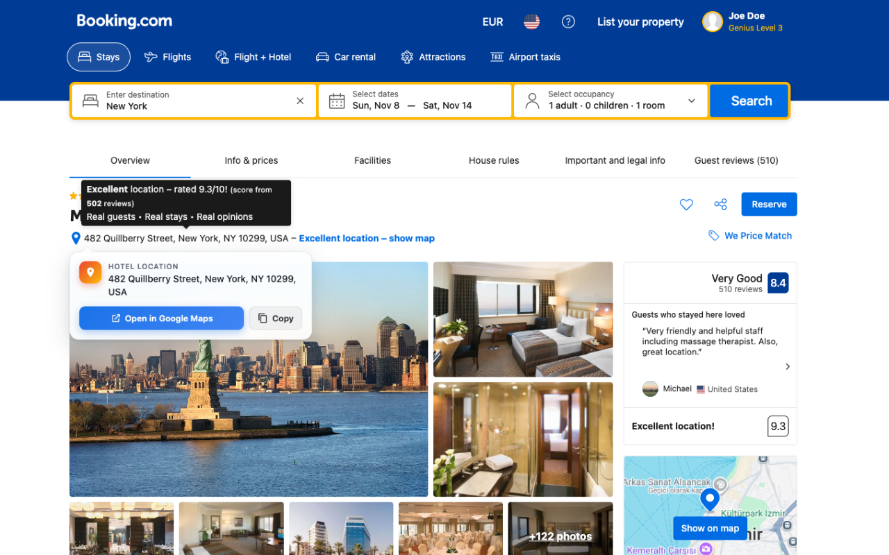

<p align="center">
  
</p>

<h1 align="center">Hotel Address to Maps</h1>

<p align="center">
  A tiny Chrome extension that makes hotel addresses on Booking.com one click away from Google Maps.
</p>

---

<p align="center">
  
</p>

## Why

Copying a hotel's address from a Booking.com hotel page is surprisingly fiddly: the address is a clickable element that opens Booking's own map, so selecting the text is a struggle. This extension fixes that.

## Features

- **Hover the address** on any Booking.com hotel page and a small card appears.
- **Open in Google Maps** – opens the hotel location in a new tab (searches by hotel name + address for an accurate pin).
- **Copy** – copies the clean address to your clipboard.
- **Localized** – buttons follow the Booking page language: English, Turkish, Dutch, German, French, Spanish, Portuguese, Italian (falls back to English).
- **Light and dark mode** – follows your system theme.
- **Private by design** – no permissions beyond Booking.com hotel pages, no tracking, no network requests, no data collection.

## Installation

### From source (developer mode)

1. Clone this repository:
   ```sh
   git clone https://github.com/emrahonder/chrome-extension-hotel-address-to-maps.git
   ```
2. Open `chrome://extensions` in Chrome.
3. Enable **Developer mode** (top right).
4. Click **Load unpacked** and select the cloned folder.
5. Open any Booking.com hotel page, for example `https://www.booking.com/hotel/...`, and hover the address.

## How it works

A content script runs only on `https://*.booking.com/hotel/*`. It:

1. Finds the address element in the property header (with fallbacks for older Booking layouts) and keeps watching the page, because Booking renders parts of it dynamically.
2. Reads the first **visible** text inside it, skipping hidden tooltips and screen-reader-only text.
3. Builds a Google Maps search URL from the hotel name and address, falling back to the page's coordinates when no address is shown.
4. Stops click events inside the card so Booking's own map modal does not open.

## Project structure

```
├── manifest.json        # Manifest V3 config
├── content.js           # Address detection, card UI, localization
├── styles.css           # Card styling (light/dark)
├── _locales/            # Localized extension name and description
├── icons/               # Extension icons (16/32/48/128) + source SVG
├── store/               # Chrome Web Store assets
└── build.sh             # Builds the store upload zip
```

## Building for the Chrome Web Store

```sh
./build.sh
# → dist/hotel-address-to-maps-<version>.zip
```

Bump `version` in `manifest.json` before each new store upload.

## Adding a language

1. Add an entry to `STRINGS` in `content.js` (keyed by the two-letter language code).
2. Add `_locales/<locale>/messages.json` with `extName` and `extDescription` (description max. 132 characters).

## Disclaimer

This project is not affiliated with, endorsed by, or sponsored by Booking.com or Google. All trademarks belong to their respective owners.
